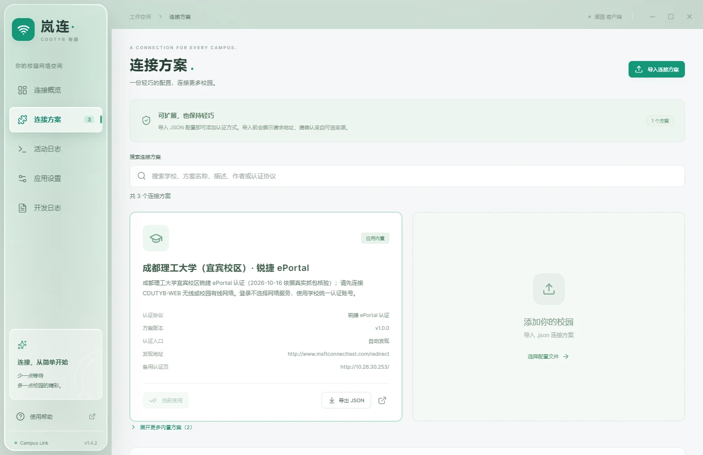
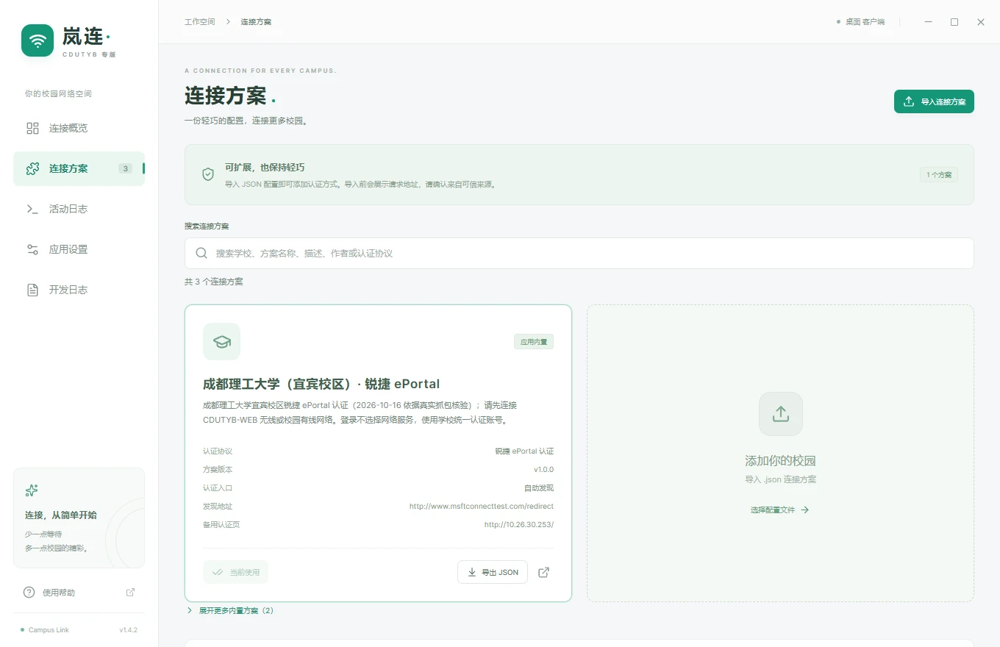

<div align="center">


# 岚连 Campus Link · CDUTYB 专版

> v1.4.2：系统加密保存密码，重启自动恢复；完善旧凭据迁移、保存失败恢复与首次引导。

**简单连接，自在校园。**

面向 Windows 和 macOS 的轻巧校园网认证工具，让连接、守护与方案管理更省心。

[](https://github.com/PowerT-0704/CampusLink/releases/latest)
[](https://github.com/PowerT-0704/CampusLink/releases)
[](https://github.com/PowerT-0704/CampusLink/actions/workflows/release.yml)
[](https://github.com/PowerT-0704/CampusLink/stargazers)

[**📥 下载 v1.4.2**](https://github.com/PowerT-0704/CampusLink/releases/tag/v1.4.2) · [**🌐 官网源码**](site/index.html) · [**📖 专版使用指南**](docs/usage.md) · [**💬 上游问题反馈**](https://github.com/65658dsf/CampusLink/issues)

开发者：**[PowerT-0704](https://github.com/PowerT-0704)**

<p><sub>当前版本 <strong>v1.4.2</strong> · 默认宜宾方案 · 默认液态玻璃 · Windows / macOS</sub></p>

基于 **[NingMeng123](https://github.com/65658dsf)** 的 Campus Link 构建；v1.4.2 增加系统加密凭据与恢复机制，默认启用「液态玻璃」外观，保留经典外观切换。

</div>

## ✨ 连接校园，少一点折腾

| | 能做什么 |
| --- | --- |
| 🔌 轻松认证 | 支持 Dr.COM、锐捷 ePortal Web 和声明式 HTTP 方案；内置方案自动发现认证入口 |
| 🛡️ 网络守护 | 检测状态、断线重连、网络变化快速检查，托盘一键暂停或恢复 |
| 🧩 灵活配置 | 搜索学校方案，导入 / 导出 JSON，扩展更多校园网络 |
| 🔐 本地凭据 | 使用系统加密保存，记住一次即可跨重启使用；也可仅在本次运行中使用，日志与诊断包不含密码或密文 |
| 🖥️ 桌面常驻 | Windows / macOS 托盘、可选开机自启动、启动后自动连接与更新检查 |
| 🔎 方便排障 | 活动日志、服务器响应详情和脱敏诊断包导出 |
| 🪟 双外观 | 经典 / 液态玻璃一键切换：玻璃侧边栏与顶栏，Win11 22H2 以上可透视桌面 |

<p align="center">
  
</p>

<p align="center"><sub>v1.4.2 当前界面离线展示，无真实账号与网络会话；系统 Acrylic 桌面透视以实际设备为准。在「应用设置 → 界面外观」随时切回经典。</sub></p>

## 🪟 两种外观，一键切换

- **液态玻璃（新安装默认）**：侧边栏与顶栏变为玻璃面板，内容在玻璃下方独立滚动；Windows 11 22H2 及以上使用系统 Acrylic 材质透视桌面，其他平台自动回退为应用内玻璃。
- **经典**：清晰的浅色界面，可随时切换；已有用户保存的外观偏好保持不变。
- 切换入口：**应用设置 → 界面外观**。只影响外观，不改变认证、凭据存储与日志行为。

<p align="center"><br /><sub>v1.4.2 经典外观 · 离线界面展示</sub></p>

## 🚀 三步开始

1. **安装客户端**：从 [v1.4.2 Releases](https://github.com/PowerT-0704/CampusLink/releases/tag/v1.4.2) 下载 [Windows x64](https://github.com/PowerT-0704/CampusLink/releases/download/v1.4.2/Campus-Link-Glass-Setup-1.4.2.exe)、[Intel Mac](https://github.com/PowerT-0704/CampusLink/releases/download/v1.4.2/Campus-Link-1.4.2-mac-x64.dmg) 或 [Apple Silicon Mac](https://github.com/PowerT-0704/CampusLink/releases/download/v1.4.2/Campus-Link-1.4.2-mac-arm64.dmg) 对应安装包。
2. **确认学校方案**：先连接校园 Wi-Fi 或网线，再到“连接方案”确认学校；默认已选中成都理工大学（宜宾校区），其他学校可在列表中切换或导入。
3. **填写账号并连接**：需要认证时输入账号密码，按需开启记住密码和自动连接。首次引导也可选择仅本次使用或跳过；已在线时可通过“管理账号密码”保存凭据，不影响当前会话。

默认内置**成都理工大学（宜宾校区）**方案；其他学校可[制作并导入 JSON](docs/plugin-guide.md)。具体部署仍需校内验证，锐捷支持范围为 ePortal 网页认证。

> macOS 将应用拖入“应用程序”后运行。当前安装包未签名，macOS 也未公证，系统可能提示拦截；详见[安装说明](docs/usage.md#安装和首次连接)。

## 📚 想了解更多

[完整使用指南](docs/usage.md) · [方案制作](docs/plugin-guide.md) · [锐捷教程](docs/ruijie-guide.md) · [版本更新](https://github.com/PowerT-0704/CampusLink/releases) · [构建与发布](docs/releases.md)

连接失败时先查看应用内日志。协议与通用客户端问题可携带脱敏诊断信息提交[上游 Issue](https://github.com/65658dsf/CampusLink/issues)；专版相关问题请通过[本项目仓库](https://github.com/PowerT-0704/CampusLink)及[维护者主页](https://github.com/PowerT-0704)了解反馈渠道（本项目当前未启用 Issues）。学校账号、欠费或设备上限问题请联系校园网服务渠道。

## 🌐 项目官网

独立静态官网位于 [`site/`](site/README.md)，以 v1.4.2 为内容基准。下载项目后直接打开 `site/index.html`，或在项目根目录运行：

```powershell
node site/preview.cjs
```

浏览器访问终端打印的 `http://127.0.0.1:4173`，按 `Ctrl+C` 停止。官网使用原生 HTML/CSS/JavaScript，GSAP 3.15.0 与 ScrollTrigger 随站点本地保存，无需安装额外依赖或构建客户端。动效、验证记录和组件占用见 [官网说明](site/README.md)与[验收报告](site/QA-REPORT.md)。

## 🛠️ 本地开发

需要 **Node.js 22.12+** 和 npm。

先进入包含 `package.json` 的客户端目录；在父目录运行 `npm start` 会提示 ENOENT。首次构建后可运行 `npm start`，日常开发使用以下命令。

```bash
npm ci
npm run dev
```

当前工作目录包含 `#` 时，可用 `node scripts/build-acceptance.cjs` 构建验收界面，再运行 `node scripts/smoke-desktop.cjs` 和 `node scripts/smoke-credentials.cjs`。后者使用 Windows 原生加密、隔离数据和本机模拟认证，验证连续重启及断线重连不需要重新输入密码。

`npm run dev:web` 预览界面；`npm test` 运行测试；`npm run build` 检查类型并构建。更多命令见[使用指南](docs/usage.md#本地开发)。文档网站源码独立维护于 [CampusLinkPages](https://github.com/65658dsf/CampusLinkPages)。

## ⭐ Star History

如果岚连帮到了你，欢迎点亮一颗 Star，让更多同学发现它。

<a href="https://www.star-history.com/?repos=PowerT-0704%2FCampusLink&amp;type=date">
  <picture>
    <source media="(prefers-color-scheme: dark)" srcset="https://api.star-history.com/svg?repos=PowerT-0704/CampusLink&amp;type=Date&amp;theme=dark" />
    <source media="(prefers-color-scheme: light)" srcset="https://api.star-history.com/svg?repos=PowerT-0704/CampusLink&amp;type=Date" />
    
  </picture>
</a>

## ❤️ 感谢贡献者

感谢每一位提交代码、完善文档、反馈问题与分享校园方案的朋友。

<a href="https://github.com/PowerT-0704/CampusLink/graphs/contributors">
  
</a>

<sub>头像由 <a href="https://contrib.rocks">contrib.rocks</a> 根据 GitHub 贡献记录自动更新，点击可查看完整列表。</sub>

## 📄 授权与许可

- 本专版基于 [Campus Link](https://github.com/65658dsf/CampusLink)（作者 **NingMeng123**）构建，已获得原作者的修改与分发授权（2026-10-16 经维护者确认）。
- 本仓库以 MIT 许可发布，见 [LICENSE](LICENSE)；上游与第三方（如 `scu_net_auto_login`）的许可以原文保留，详见[第三方声明](assets/licenses/README.md)。

---

岚连是独立校园网辅助工具，与学校或认证服务商无官方隶属关系。使用外部方案前请核对认证地址；[隐私说明](docs/usage.md#密码与本地数据) · [第三方声明](assets/licenses/README.md)。
